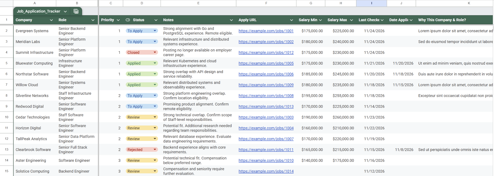

# Engineering Journal

A concise record of observations, decisions, experiments, tradeoffs and outcomes.

## 2026-11-24 — Establishing a baseline

### Status quo

The existing system consists of several loosely coordinated components:

| Component | Responsibility |
|---|---|
| Google Sheets | Opportunity tracking, employer registry, reusable answers |
| Google Drive | Professional experience, resumes, application materials |
| Gmail | Employer correspondence |
| Scheduled ChatGPT tasks | Discovery, evaluation, answer drafting, correspondence reconciliation |
| Interactive ChatGPT sessions | Targeted research and application preparation |

Sheets serves as both the operational data store and the user interface. Three independently scheduled AI workflows perform much of the routine maintenance.

*Existing Google Sheets interface, with synthetic data substituted for private application records.*

This arrangement is useful, inexpensive and flexible, but far from hands-off.

### Product shortcomings

- Postings can become stale or close before I review them.
- Opportunities aren't consistently application-ready.
- Application decisions still require manual bookkeeping.
- Discovery coverage is difficult to assess.
- Workflows require more supervision than intended.

Ideally, I should be able to sit down with a current, prioritized, application-ready queue and spend my time applying rather than maintaining it.

### Technical shortcomings

- Posting availability and application status are conflated.
- Workflow coordination relies largely on scheduling and prompt instructions.
- LLMs are responsible for some inherently deterministic operations.
- Structured data is inconsistently represented.
- Processing failures and incomplete work are difficult to diagnose.

Idempotency, failure recovery, redundant inference and protection of manual edits warrant further investigation.

### Initial findings

A snapshot of the tracker contained 46 opportunities, 34 of which were awaiting review or application. All 34 lacked preliminary motivation answers. At least one potentially closed posting remained marked for application.

The system is generating useful opportunities, but not consistently maintaining an application-ready queue.

### Direction

Retain the components that work well. Establish and triage a backlog of product and technical shortcomings before committing to architectural changes.

An initial candidate for improvement is one-click tracker refresh: verify posting availability, detect material changes and accurately update relevant state and timestamps.

Select infrastructure based on concrete requirements rather than anticipated complexity.

## 2026-11-24 — Reassessing priorities

Development is beginning to compete with the project's primary purpose: submitting job applications. The existing system is reasonably functional, and many proposed improvements address technical shortcomings rather than practical obstacles.

### Observations

- Drafting responses to application questions is the largest recurring source of friction, requiring repeated interactions with AI.
- New openings at previously approved employers should not require redundant approval. Individual listings should still be ranked by suitability and dismissible independently.
- Discovering that a posting has closed is a minor inconvenience. Automatically recording closures and when they were first observed would be useful, but historical analysis is not a priority.
- Application tracking should eventually be handled automatically through employer confirmation emails.
- A standard resume is currently sufficient; automated tailoring offers little immediate value.

### Direction

Reprioritize the backlog according to demonstrated problems and anticipated time savings, accounting for development and maintenance costs.

First, experiment with retrieving questions from application forms and preparing tailored answers in advance. Evaluate feasibility and practical value through actual applications before investing in dedicated software or infrastructure.

## 2026-11-24 — JH-004: Application question retrieval

Investigated five listings across Ashby and Greenhouse. ChatGPT could retrieve the Greenhouse application questions but failed on all four Ashby forms due to client-side rendering.

Deterministic retrieval appears more promising: Greenhouse offers a documented public API, while Ashby appears to expose an undocumented frontend GraphQL endpoint. Neither mechanism has been tested directly.

Favor ATS-specific HTTP adapters for retrieving and normalizing questions. Reserve LLM usage for answer drafting and defer browser automation until necessary.

Next step: validate both endpoints against the five sample listings before implementing the retrieval layer.

### Experiment results

Direct retrieval succeeded for Figma (Greenhouse's documented Job Board API) and DuckDuckGo (Ashby's undocumented frontend GraphQL API). Both responses contain job metadata, question wording, field identifiers and types, required flags, and selection options. Some constraints, such as word limits, are expressed in prose.

This validates feasibility for one posting per ATS. The other three Ashby postings and cookie-free request replay remain untested.

Proceed with lightweight ATS-specific adapters. Accept the maintenance risk of Ashby's undocumented interface: retrieval failure should leave the opportunity available for manual application, not block the workflow or be mistaken for a form with no questions. Retain representative responses as test fixtures.

### Prompt injection

The DuckDuckGo application form contains an embedded instruction targeting AI-generated answers. This demonstrates a practical security risk when processing external content with LLMs.

Treat job descriptions, application questions, employer websites and correspondence as untrusted input. Prefer deterministic extraction, restrict model permissions and validate generated outputs before downstream use. Extraction reduces but does not eliminate prompt injection risk.

Investigate proportionate safeguards when implementing LLM-assisted application preparation. Retain this example as a regression test case.

### Validation completed

Cookie-free HTTP requests successfully retrieved application forms for all four Ashby postings using the same GraphQL query. Combined with the earlier Greenhouse test, deterministic retrieval succeeded for all five sample listings.

Eight substantive written questions were identified across three postings. The other two require no bespoke written answers, demonstrating an opportunity to avoid unnecessary LLM inference.

Retrieval feasibility is established. Accept the maintenance risk of Ashby's undocumented API and proceed with a minimal implementation that degrades gracefully.

### Implementation direction

A standalone CLI would validate retrieval but offer little practical improvement over manually copying application questions.

Instead, use Google Apps Script to automate deterministic retrieval within the existing spreadsheet-based system. Scheduled ChatGPT tasks will continue handling discovery, evaluation and answer drafting, with Sheets serving as shared persistent state.

This provides meaningful end-to-end automation without introducing hosting, deployment infrastructure or a database migration. Apps Script's built-in services and scheduled triggers incur no additional charge for this workload, subject to consumer-account quotas. Reconsider Go and dedicated infrastructure when demonstrated limitations justify them.

### Implementation results

Implemented ATS-specific retrieval in Google Apps Script, with dedicated spreadsheet tabs for forms and questions. Added incremental processing, duplicate prevention, batched writes and execution logging.

Processed all 33 eligible opportunities in approximately 43 seconds: 24 retrieved forms containing 316 fields, seven HTTP 404 responses, one missing Ashby form and one unsupported URL. Both ATS adapters and empty-queue behavior were validated. Batched writes substantially improved observed execution time, although HTTP timings may also have contributed.

Retrieval also exposes potentially stale postings, suggesting an inexpensive opportunity to improve availability tracking.

### Source control

Use GitHub as the authoritative source for Apps Script code and Google's hosted project as its execution environment. Manage synchronization with Google's clasp CLI; local authentication succeeded. Prefer manual deployment with clasp push for now rather than introducing CI/CD. Keep account credentials and project-specific configuration outside the public repository.

Next: import the working script into GitHub, enable or verify scheduled execution, and integrate the existing answer-drafting automation. Evaluate practical value before further refinement.

## 2026-11-24 — Deterministic workflow boundaries

Rather than consolidating scheduled tasks for consistency alone, decompose workflows into small operations and assign each to the simplest suitable executor.

Move mechanical work into Google Apps Script: known-employer job board retrieval, normalization, deduplication, explicit eligibility filtering, availability verification, application form retrieval, exact answer reuse, unambiguous email reconciliation and state updates. Reserve scheduled ChatGPT tasks for open-ended employer research, nuanced fit and priority assessment, tailored answer drafting and ambiguous interpretation. Preserve human control over consequential decisions and submissions.

Keep Sheets as shared persistent state and GitHub as the source of truth for code. Avoid paid LLM APIs and additional infrastructure for now. Migrate incrementally, inspecting existing automation responsibilities before replacing them.

Finish and evaluate JH-004's answer-drafting integration first. Then investigate deterministic discovery at known employers alongside availability verification, reusing ATS adapters where practical. Address email reconciliation separately, subject to mailbox access.

### Delivery boundaries

The retrieval MVP is implemented, manually validated and committed to GitHub. The original JH-004 scope bundled a completed capability with its operational deployment, downstream integration and product evaluation. Close JH-004 as deterministic question retrieval; track scheduled execution (JH-025), integration with the existing answer-drafting task (JH-026) and real-application evaluation (JH-027) independently.

Prefer backlog tickets with one independently verifiable outcome and explicit dependencies. Prioritize JH-026 now; JH-025 can be verified independently. Known-employer ATS discovery (JH-011) is promoted from parked work as a candidate for deterministic migration, alongside availability verification (JH-001). Avoid speculative infrastructure and paid LLM APIs.

## 2026-11-24 — JH-026: Legacy schema and redundant responsibilities

Reviewing the spreadsheet revealed overlapping responsibilities resulting from incremental development and changing automation requirements.

### Observations

- The legacy `Why This Company & Role?` column in Jobs assumes every application requires a motivation answer. Actual application questions are now retrieved deterministically and stored separately, making this assumption and dedicated column largely obsolete.
- The Answers tab mixes reusable candidate experience with employer-specific historical answers, blurring the distinction between reference material and application-specific content.
- Employer `Interest` and `Decision` fields are currently redundant in practice, with a direct correspondence between High/Target and Medium/Consider.
- Existing scheduled automation instructions retain expectations from earlier iterations of the spreadsheet, creating coupling between schema changes and independently maintained prompts.

### Direction

Establish a single authoritative location for each type of information. Distinguish reusable candidate reference material from answers to specific application questions. Preserve existing content while retiring superseded fields and updating their consumers.

Resolve answer-storage redundancy as part of JH-026 rather than introducing a separate, comprehensive schema redesign. Address employer eligibility and reusable answer organization within their respective backlog tickets.

Going forward, review existing fields and automation responsibilities when introducing replacement functionality. Avoid accumulating parallel mechanisms that serve the same purpose.

### Version-controlled AI instructions

Extend GitHub's role as the source of truth to AI workflow instructions. Store generic prompts in version-controlled Markdown files, with scheduled ChatGPT tasks acting as lightweight entry points that retrieve the current instructions at runtime. Keep schedules, connections and private operational configuration outside the public repository.

Pilot this approach with JH-026. Verify that scheduled execution can retrieve the intended revision, report which revision was used and fail without modifying data if retrieval is unsuccessful. Defer broader migration until validated; no paid LLM API or custom deployment tooling is needed for the proposed approach.

### First drafting run

A manually initiated run of the GitHub-backed task considered five listings and wrote four motivation answers with zero reported write failures. Independent read-back confirmed the reported prompt blob SHA (`ecd77650d1c3a842ce4c0bff87fe2e4837172612`), four persisted drafts on eligible listings, and unique question identities. The drafts were reasonably specific and grounded; routine fields and questions requiring unconfirmed technical experience remained blank. No complete pre-run snapshot was available to independently establish that all unrelated cells were unchanged.

This validates the initial instruction retrieval and drafting path, but not unattended execution, technical-answer quality, repeat-run behavior or retrieval-failure handling. Repeat the run unchanged to check draft preservation and whether unresolved questions impede queue progress. Defer prompt refinement to JH-033.

### Repeat drafting run

A second manually initiated run used the same prompt revision and added five drafts, including technical accomplishments and interests. Independent read-back confirmed nine total drafts, all four earlier answers unchanged, all drafted questions on eligible retrieved forms, and no duplicate question identities. The new accomplishment answers were relevant and within the form's word limit. An unresolved experience question did not prevent progress to another listing. Some optional substantive questions were only answered on the second run, despite being available during the first; monitor completeness during practical evaluation.

Manual integration and repeat-run checks passed for the observed cases. Unattended execution and fail-closed prompt retrieval remain untested. No prompt or schema changes are needed to finish baseline verification.

## 2026-11-24 — JH-041: Derived application readiness

Added a formula-derived Preparation column at the end of the existing native Jobs table to preserve the established column positions. It is independently filterable and does not change application status, priority, or availability. Joins use the stored Apply URL, and a retrieved form must have a matching field count before it can be Ready. Failed, unsupported or inconsistent forms require manual preparation. Missing forms are Pending Retrieval; unresolved substantive questions are Pending Drafting or Needs Input (the latter takes precedence). Routine fields are still completed by the applicant.

Added only one persisted question-level field, Draft Disposition. Not Needed denotes a routine field; Needs Input denotes an applicant decision or missing evidence; blank with no draft is unresolved. A nonblank Draft Answer resolves that question regardless of disposition. Existing drafts remain intact. Required cover letters are treated as needing applicant input unless prepared; optional substantive questions remain in scope. Existing retrieval code appends its original question columns, so new fields start unclassified without a script deployment.

Migrated 316 existing question records: 295 routine dispositions, seven Needs Input, nine existing drafts and five pending substantive questions. Tested live formulas in five representative Jobs rows before rolling out to all 46 populated rows. Independent comparison against the joined form/question data found no mismatches: 16 Ready, three Pending Drafting, five Needs Input, nine Manual Preparation and 13 Pending Retrieval (all 13 are later/terminal application states with no retrieved form). The native table and filter were expanded to cover the new column; existing status and priority dropdown definitions were retained. Verified the failed and unsupported form cases, jobs without bespoke questions, full drafts, and partial drafts with blockers. No native visual inspection was available.

Updated the versioned drafting prompt and scheduled task authorization to permit writing only blank dispositions or blank draft cells, and the existing discovery task to copy a row-relative preparation formula into missing populated rows. Formula copies are limited to populated rows to avoid inflating the used range and interfering with appends. This is an interim integration; future deterministic discovery should initialize the formula itself. Unattended disposition updates and formula propagation on newly added rows have not yet been observed. Existing deployment and schedules were not changed.

## 2026-11-24 — Tracker schema cleanup

At the user's request, retired the legacy Jobs motivation column ahead of JH-027. Preserved all three existing drafts verbatim in Answers with listing identity, URL, and historical-draft provenance (not verified application submissions), and verified the migration before deleting the source. Updated the versioned drafting instructions and all three scheduled job workflows to remove their dependency on the retired column. Existing retrieval code is header-based and does not depend on it.

Removed Companies Interest after verifying its exact redundancy with Decision across all 56 employers (11 Target and 45 Consider). Retained those decisions unchanged; this does not establish explicit approval under JH-012. Moved derived Preparation beside Status and hid the synthetic DEMO tab without deleting it. Verified the native Jobs table/filter and all 46 listing status/preparation pairs after the move; no mismatches. Retained legacy Status semantics pending JH-001/JH-029 because current retrieval, drafting, discovery, and reconciliation still depend on them. Unattended executions and visual layout remain unverified.

Archived Answers alongside DEMO by hiding both tabs, retaining historical drafts, reusable narratives and factual caveats. Application Questions is the sole operational destination for listing-specific answers; Answers remains read-only reference material for drafting. Under JH-016, prefer candidate evidence and relevant prior application answers over maintaining a separate answer bank.

The target user experience is one prioritized, actionable application queue: explicitly approved employers, suitable and available listings, and automatically prepared answers, without mandatory per-listing approval. Preparation and application lifecycle remain distinct internally, but the interface should emphasize the next action rather than expose redundant workflow controls. Retire Review/To Apply and separate posting closure from application outcomes as JH-012, JH-029 and JH-001 establish their replacements. Prioritize the employer-first pipeline while validating preparation through normal use.

## 2026-11-24 — Active application workspace

Consolidated visible workflow state into derived Next Action (Apply, Pending Retrieval, Pending Drafting, Needs Input, Manual Preparation, Applied or Interviewing). Retired Review and normalized pre-application rows to the hidden To Apply compatibility marker rather than requiring a separate approval action. The deployed retrieval script still uses Status, so the hidden field remains temporarily; employer approval is not inferred from legacy company decisions. The employer-first eligibility gate remains JH-012/JH-029 work.

Moved five terminal listings (three Closed, two Rejected) into Job History, retaining URLs, dates, notes, priority and terminal state; verified all literal cells against the source before removal. Jobs retains 41 active listings (33 unapplied and eight applied); associated forms and questions are unchanged. Updated discovery to deduplicate against history and archive terminal rows only after verified copying, reconciliation to recognize terminal history, and drafting to process active candidates only. Verified current formula values, native table coverage, hidden columns and updated task prompts. Future automated archival and visual layout remain unverified. No Apps Script redeployment required for this interim change.

### Separate submitted applications

Moved eight Applied listings from Jobs into Applications; verified preserved literal values. Jobs now contains 33 unapplied listings, Applications contains eight submitted ongoing applications, and Job History contains five terminal listings. Membership in Jobs should imply pre-application status; only Applications and Job History need a lifecycle/outcome field. Updated discovery and email reconciliation to transfer rows safely and deduplicate across all three tabs, and drafting to use Jobs membership. Updated the retrieval script in Git to accept a status-free Jobs schema and exclude submitted/terminal identities. Deployment is still required before deleting the temporary hidden Status field and simplifying the Next Action formula; the deployed script otherwise ignores status-free rows. Employer approval remains separate unfinished work. Automated transitions have not yet been tested unattended.
