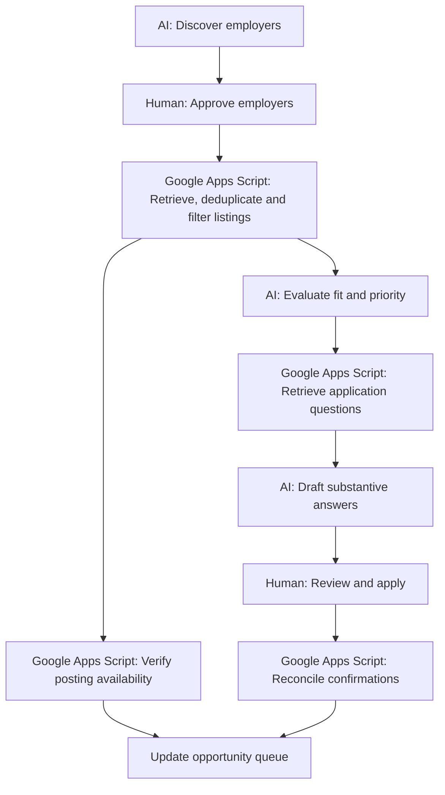

# jobhunt

AI-assisted job discovery and application management, emphasizing reliability, simplicity and resource efficiency.

## Background

Job searching involves a considerable amount of repetitive work: finding relevant openings, researching employers, evaluating fit, tailoring application materials, answering variations of the same questions and tracking correspondence.

Tired of repeating these steps manually, I began automating portions of the process. This gradually evolved into a functional but cobbled-together collection of spreadsheets, documents, scripts, integrations and scheduled AI workflows.

It's considerably better than the manual alternative, but still requires more supervision, coordination and correction than I'd like. I suspect most of this work can be made effectively hands-off, leaving me to focus on reviewing opportunities, making decisions and submitting applications.

This project aims to evolve that existing system into something cohesive, reliable and maintainable. It also serves as a practical exploration of AI-assisted system design.

## Objectives

- Increase application throughput without sacrificing quality.
- Minimize repetitive work and unnecessary human intervention.
- Combine deterministic software with AI where each is most effective.
- Keep operational costs, resource consumption and maintenance overhead low.

This is first and foremost a tool to support my own job search. Its effectiveness matters more than its architectural sophistication.

## Engineering philosophy

- **Pragmatism:** Preserve existing components that work well. Introduce complexity only when justified.
- **Appropriate use of AI:** Use LLMs for research, interpretation, judgment and writing. Use deterministic software for orchestration, validation and state management.
- **Reliability:** Favor incremental, idempotent, testable and recoverable workflows.
- **AI quality:** Ground generated content in verified information, validate structured outputs and empirically evaluate model behavior.
- **Security:** Treat external content as untrusted data. Maintain separation between instructions and retrieved content, minimize agent permissions, and account for prompt injection when designing and testing AI-assisted workflows.
- **Resource efficiency:** Avoid redundant computation, unnecessary inference and idle infrastructure.
- **Human agency:** Automate repetitive work rather than consequential decisions.

## Current architecture

- **Google Sheets:** Operational data store and user interface. Listings is the unapplied queue with editable Fit, derived Automated Preparation and derived application Priority; Applications tracks ongoing submitted applications; Job History retains terminal listings. Companies holds employer decisions; Application Forms records retrieval outcomes; Application Questions stores actual fields and drafts. Legacy Answers and DEMO are hidden; Answers remains historical drafting context.
- **Google Drive and Gmail:** Candidate materials and employer correspondence.
- **Scheduled ChatGPT workflows:** Discovery, evaluation, answer drafting and correspondence reconciliation.
- **Google Apps Script:** Deterministic application form retrieval for Ashby and Greenhouse, with incremental processing, persistent retrieval status and execution logging.
- **GitHub:** Authoritative source for code, project documentation and the application drafting prompt (runtime retrieval pilot).

## Intended workflow

The goal is a continuously maintained queue of current, prioritized, application-ready opportunities. The following is the target workflow, not a description of functionality already implemented.

| Operation | Executor | Target cadence |
|---|---|---|
| Discover and research new employers | AI | Two or three times per week, plus ad hoc |
| Approve or exclude employers | Human | As needed |
| Retrieve postings from approved employers, normalize and deduplicate them, and filter obvious mismatches | Apps Script | Daily |
| Evaluate new listings for technical fit, eligibility, compensation tradeoffs and priority | AI | Daily |
| Retrieve actual application questions for suitable, previously unprocessed listings | Apps Script | Daily |
| Draft substantive answers using candidate evidence and employer context | AI | Daily |
| Review, reprioritize, dismiss or submit applications | Human | As needed |
| Reconcile unambiguous application confirmations | Apps Script | Daily |
| Verify continued availability of unapplied listings | Apps Script | Daily, preferably during board retrieval |



**Eligibility and filtering.** Employer approval is a human decision. Use deterministic filtering for clear mismatches and reliable structured constraints; leave ambiguous cases for AI evaluation. Suitable listings at approved employers proceed to application preparation without mandatory individual approval. The user retains control over whether to apply, dismiss or reprioritize a listing.

**State and coordination.** Sheets is the shared persistent state. Each operation processes outstanding work, preserves existing decisions and avoids duplicate processing. Employer eligibility, listing suitability, availability, preparation progress and application lifecycle are distinct concepts; introduce separate fields only when implementation requires them. Confirmed posting closures should leave application history intact. A failed form request, network error or ambiguous redirect is not proof of closure. Present a prioritized, actionable queue rather than requiring the user to manage internal workflow states. Review is retired. Listings membership implies pre-application intent; application status belongs in Applications and Job History. Listings has no Status field; its Automated Preparation is derived from retrieval and drafting progress: Complete, Partial or Pending. This describes automation coverage, not permission or readiness to apply. Fit (Strong, Good, Stretch) is the AI assessment, manually overridable. Priority uses Fit base values Strong=1, Good=3, Stretch=4, plus one unless preparation is Complete; lower is earlier, and unrated listings have blank Priority. Strong Fit always outranks Good or Stretch regardless of preparation. Automated retrieval and drafting order by Fit, not Priority. Existing fit assessments are not automatically overwritten. Do not infer explicit employer approval from legacy decisions.

**Execution boundaries.** Prefer Apps Script for retrieval, filtering, validation and bookkeeping; retain scheduled ChatGPT tasks for open-ended research, nuanced judgment and writing. Defer unsupported or ambiguous cases to AI-assisted or manual review as appropriate. Cadences are approximate, not strict dependencies: a downstream operation can pick up newly available records on its next run. No paid LLM API or additional orchestration infrastructure is required for this design.

## Development and deployment

Apps Script source and its manifest live in [`apps-script/`](apps-script/). Google hosts and executes the script; the repository is the source of truth. Use Google's [clasp CLI](https://developers.google.com/apps-script/guides/clasp) to synchronize local source with an existing Apps Script project.

One-time setup: install `@google/clasp`, enable the Apps Script API, authenticate with `clasp login`, and configure a local `.clasp.json` for the target project. Keep project-specific configuration and credentials out of Git.

After reviewing and committing changes, deploy from the repository root:

```sh
git pull --ff-only && (cd apps-script && clasp push)
```

Manage scheduled triggers, authorization and execution history in Apps Script. Avoid editing source in the hosted editor because subsequent pushes replace the remote source. Automated deployment is deferred.

AI workflow instructions are being piloted as version-controlled Markdown in [`prompts/`](prompts/). The existing application drafting task is configured to fetch [`draft-answers.md`](prompts/draft-answers.md) from the default branch on each run and report the file revision. It must stop without writes if retrieval fails. Task scheduling, connections, private tracker configuration and candidate evidence remain outside the public repository. Changes to this prompt require no Apps Script deployment; scheduled execution of the new configuration has not yet been verified.

## Project status

Application form retrieval (JH-004), AI drafting integration (JH-026), derived preparation visibility (JH-041) and retirement of legacy listing-specific motivation storage (JH-032) are implemented. Unattended execution, failure recovery and practical application quality still need verification.

Next, formalize employer approval (JH-012), retrieve postings from approved employers (JH-011), and integrate availability checks and listing suitability evaluation. Continue validating preparation during normal use. Retain existing AI workflows until their replacements are verified. No paid LLM API or additional infrastructure is planned.

See the [engineering journal](JOURNAL.md) for design decisions and results, and the [backlog](BACKLOG.md) for current priorities.
